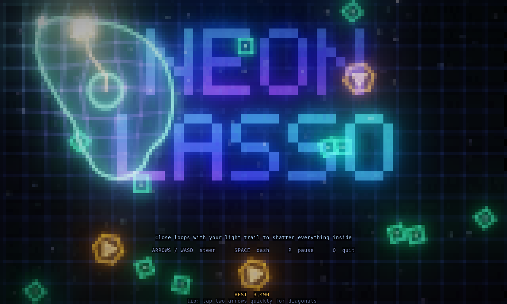
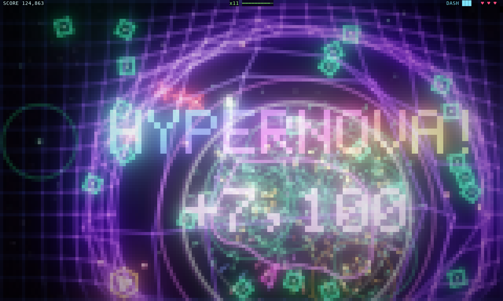
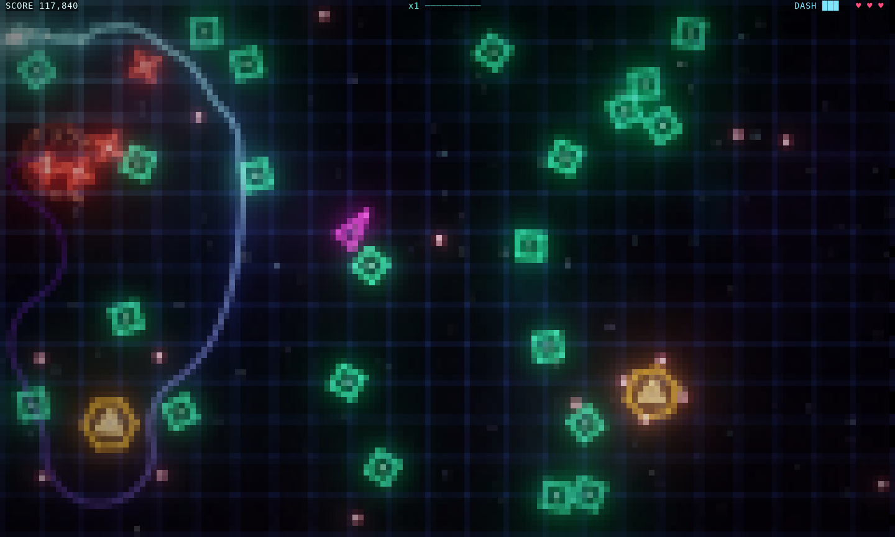

# NEON LASSO

A fast, flashy arcade game that runs entirely in your terminal.





You are a comet of light dragging a glowing trail. **Cross your own trail to close a loop, and everything inside the loop shatters.** Catch more enemies in one loop for bigger multipliers, screen-shaking SUPERNOVAs, and slow-motion HYPERNOVAs. Touching an enemy or a bullet head-on costs a life.

## Run

```sh
cargo run --release
# or after building:
./target/release/neon-lasso
```

Use a truecolor terminal (kitty, WezTerm, Ghostty, Alacritty, iTerm2, Windows Terminal, GNOME Terminal…). Bigger windows give you a bigger arena; 120×40 or more is ideal.

## Controls

| Key | Action |
| --- | --- |
| Arrows / WASD / HJKL | Steer (the comet always flies; you choose the heading) |
| Space | Dash: a short invulnerable speed burst that uses one energy cell |
| P / Esc | Pause |
| Enter | Start / resume / retry |
| Q | Quit |

In terminals that support the kitty keyboard protocol you can hold two arrows for diagonals. In other terminals, tap two arrows quickly instead.

## Enemies

- **Drifters** (green diamonds): wander about. Good lasso fodder, especially in **SWARM** rings.
- **Seekers** (magenta darts): chase you.
- **Snippers** (red spinning crosses): hunt your trail and **cut it**.
- **Spinners** (orange hexagons): fire rotating bullet bursts. Bullets caught in a loop pop for points.



Kills spill golden shards that home in on you for bonus score. The multiplier rises with every enemy you lasso and decays if you stop looping.

## Under the hood

This is pure Rust with `crossterm` as the only dependency. Every terminal cell shows two pixels using `▀` with 24-bit foreground and background colours. Each frame is rendered into an HDR float buffer with additive blending, then put through a two-level bloom, a filmic tonemap, a vignette and chromatic aberration. It is drawn inside synchronized-update escape codes and only changed cells are sent. The background is a spring-mass grid that ripples away from explosions.

Fun extras:
- `NEON_LASSO_BOT=1` lets the lasso AI from the title screen play the real game (`NEON_LASSO_BOT=god` makes it invincible).
- `NEON_LASSO_STATS=1` prints frame-time and bandwidth stats on exit.
- Your high score is saved to `~/.neon_lasso_best`.
